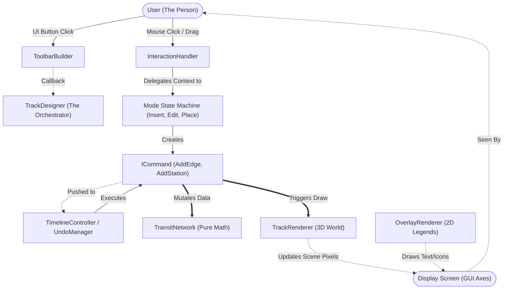

# Track Designer Architecture: A Developer's Deep Dive

Welcome to the **Ocean Library Track Designer**. As a developer, the first thing you need to understand is that this application uses a strict decoupling pattern. The User Interface has absolutely zero idea how to calculate curved geometry, and the Math Engine has absolutely zero idea what a "pixel" or "mouse click" is. 

Everything is bridged by a **Command Pattern** + **State Machine** architecture.

## The Core Architecture

Here is how the systems talk to each other loop from your screen into the backend and back out to the pixels:



---

## The Startup Sequence (Ground Zero)

Before any user interactions happen, the system must boots up. Here is exactly what happens when you run:
```matlab
td = OceanViz.Designer.TrackDesigner();
td.launch();
```

### 1. `TrackDesigner()` Instantiation
* When the constructor runs, **no GUI is created yet**.
* The class strictly builds the *Internal Models and Controllers*.
* It quietly instantiates `obj.Transit_ = OceanMath.Transit.TransitNetwork()`. At this split second, the app consists of nothing but an empty array of mathematical nodes and an empty digraph in RAM. 

### 2. `td.launch()` Execution
* Now, the graphics are forcibly generated. 
* A `figure` handle is created (`obj.Figure_ = figure(...)`) taking over the screen. MATLAB's UI rendering thread is forced to initialize using a `drawnow` block.
* A massive 2D/3D `Axes_` canvas is created taking up 92% of the screen.
* The `TrackRenderer` is instantiated and permanently bound to `Axes_`. It waits eagerly to start plotting splines.
* The `ToolbarBuilder` is called. It creates physical `uicontrol` buttons and rigidly binds their `Callback` functions to point right back into `TrackDesigner` methods (e.g., binding the Undo button to `TimelineController_.undo()`).
* **The Standby Mode**: The orchestrator finally calls `setMode_('place')`. The UI is now completely locked, loaded, and waiting for the player to touch the screen.

---

## 10 GUI Interaction Scenarios (Complete Event Cascades)

### 1. The User Swaps to "Insert Route" Mode
* **UI Action**: The user clicks the "Build Tracks" toggle button natively rendered via MATLAB's `uicontrol`.
* **Behind the Scenes**:
  1. The `uicontrol` executes its internal closure callback attached during `ToolbarBuilder`, immediately firing `InteractionHandler.setMode_('insert')`.
  2. The `ModeManager` reaches into memory and physically executes `obj.ActiveMode_.onExit()` on whatever the previous mode was. This sweeps through the graphics arrays, forcefully deleting dangling elements (e.g., hiding orange Bezier control point handles and safely unbinding their `WindowButtonMotionFcn` listeners so they don't crash MATLAB).
  3. A new instance of `OceanViz.Designer.Modes.InsertMode` is instantiated.
  4. `InsertMode.onEnter()` runs. It immediately traverses the `TrackRenderer.StationHandles_` and modifies their `HitTest` and `ButtonDownFcn` properties, wiring them up to passively wait for station-to-station routing clicks.

### 2. Placing a Brand New Station
* **UI Action**: The user clicks completely empty canvas space (the background grid) in "Place" mode.
* **Behind the Scenes**:
  1. MATLAB fires the global `ButtonDownFcn` embedded on `obj.Axes_`. This directly hits `InteractionHandler.onAxesClick_()`.
  2. `InteractionHandler` aggressively extracts the `CurrentPoint` property from `Axes_`. It transposes the hardware cursor coordinates from operating system Pixel Space perfectly into Cartesian Graph Data Space `[X, Y, Z]`.
  3. It detects that the cursor collided with no specific SVG graphics, so it routes the raw `[X, Y]` coordinate payload directly into `PlaceMode.onAxesClick()`.
  4. `PlaceMode` validates the bounds, generates an `OceanViz.Designer.Commands.AddStationCommand` injected with the `[X, Y]`, and submits it to the `TimelineController`.
  5. The Command resolves via double-dispatch:
     * **Math Commit**: Calls `TransitNetwork.addStation(X,Y)`. Internally, this permanently resizes the pure math `DigraphCus` arrays and registers the topological ID mapping.
     * **Graphics Commit**: It instructs `TrackRenderer.drawStation()` to append a custom line/scatter marker to `obj.StationHandles_`, physically stamping it onto the `Axes_` coordinate space so the User can finally see it.

### 3. Drawing a Route Between Two Stations
* **UI Action**: In "Insert" mode, the user points their mouse exactly on Station 1, clicks, then points at Station 2, and clicks.
* **Behind the Scenes**:
  1. User clicks Station 1. Because the Station marker has `HitTest = 'on'`, the click entirely bypasses the Axis background and natively hits the Marker's own `ButtonDownFcn`. The callback feeds the raw, static `Station ID` straight into `InteractionHandler.onStationClicked_(nodeId)`.
  2. `InsertMode` intercepts it. Realizing it is the "Source" click, it safely caches the ID inside `obj.SourceStation_` and instructs `TrackRenderer` to violently change the node's `MarkerFaceColor` property to highlight it visually.
  3. User clicks Station 2. `InsertMode` catches the second `HitTest` callback and detects conclusion. It resets the station highlight and commands `TrackDesigner.connectStations(id1, id2)`.
  4. **Core Geometry**: `GeometryBuilder.buildRoute_()` creates a fresh `OceanMath.Geometry.CatmullRomSpline` object parameterized mathematically through the `[X,Y]` physical distances.
  5. **Command Architecture**: An `AddEdgeCommand` is initialized, wrapping the spline object, and thrown to the Undo stack.
  6. **Mathematical Commit**: `TransitNetwork.addRoute()` inserts the literal mathematical `spline` object into indexed cell mappings corresponding to `DigraphCus` Edge counts.
  7. **Rendering Commit**: `TrackRenderer` statically allocates a massive sample matrix from the spline, mapping coordinates to 3D `Line` handle objects with the appropriate Line Data Colors, and injects them safely into `obj.CurveHandles_`.

### 4. Sculpting a Curve (Full Mouse Event Chain)
* **UI Action**: In "Edit" mode, the user clicks, holds, drags, and lets go of a small orange control point.
* **Behind the Scenes**:
  1. **Mouse Down (Grab)**: The user clicks the `DraggablePoint` UI marker. The marker's internal `ButtonDownFcn` switches it into a "dragging" state and emits an `OnGrab` event.
  2. **Grab Callback**: `InteractionHandler.onControlPointGrabbed_(edgeIdx, cpIdx, startPos)` catches the event. It securely caches the starting position of the point so we can record an Undo frame later.
  3. **Mouse Move (Drag)**: As the user sweeps the mouse, the figure's `WindowButtonMotionFcn` triggers 60 times a second. The marker follows the cursor and rapidly fires `OnMove`.
  4. **Move Callback**: `InteractionHandler.onControlPointMoved_` triggers. It fetches the underlying Math Spline object and calls `spline.setControlPoint(cpIdx, newPos)`. **Crucially, this does NOT create a new spline object; it mutates the existing matrix inside RAM in-place**, ensuring blazing fast 60 FPS performance without flooding the garbage collector. It bypasses the Undo stack entirely to force `TrackRenderer.updateCurve()`.
  5. **Mouse Release (Drop)**: The user releases the click. `WindowButtonUpFcn` terminates the dragging state and fires `OnRelease`.
  6. **Release Callback**: `InteractionHandler.onControlPointReleased_` runs. It creates exactly one `MoveControlPointCommand` containing the cached `startPos` and the final `newPos` and pushes it into the `TimelineController` where the historical state is officially recorded.

### 5. Forming a Shared Corridor (The Candy-Shell Effect)
* **UI Action**: The user draws the Green Line perfectly connecting the *exact* same stations as the Red Line.
* **Behind the Scenes**:
  1. `TrackDesigner` natively queries `TransitNetwork.findParallelRoutes()`. The math backend evaluates the graph topology and discovers two distinct math routes resolving the identical A->B `Digraph` sequence.
  2. `TrackDesigner.updateParallelStyles_` kicks in as the resolution orchestrator.
  3. It overrides the Green Line's internal math logic safely setting it to an exact mathematical clone of the Red line (`obj.Transit_.updateRouteSpline()`), so they curve perfectly synchronously.
  4. **The Z-Stack Rendering Hack**: It calculates rendering hierarchy. It commands `TrackRenderer` to mutate the bottom Red line graphics handle to be extra thick (`LineWidth=7`, `ZOffset=0.0`), and forcefully modifies the Green line handle drawing it thinner (`LineWidth=3`) layered physically above it (`ZOffset=0.3`).
  5. It executes `setHaloVisibility(ei, false)` turning off the opacity flag so the top line's white border mathematically vanishes, preserving the nested appearance.

### 6. Zooming Out the Camera (LOD Culling)
* **UI Action**: The user scrolls the mouse wheel backward, zooming the map out to see the whole city layout.
* **Behind the Scenes**:
  1. A hidden, decoupled MATLAB `addlistener()` attached natively to the specific Axes' `XLim` and `YLim` graphics properties instantly intercepts the viewport array bounds change.
  2. The hook directly triggers `TrackRenderer.applyFocus(false)` bypassing all user-interface UI tools entirely.
  3. The internal Level of Detail (LOD) architecture aggressively parses the current aspect ratio scale factor based on screen height.
  4. Realizing the scale has drifted beyond the maximum visibility threshold, it loops through thousands of pure Handle Graphics text objects within `LabelHandles_`.
  5. It bulk sets `set(Handle, 'Visible', 'off')`. Only mathematical nodes flagged uniquely as Major Hub/Terminal interchanges are permitted to skip the sweep, ensuring visual crispness while preventing CPU choking.

### 7. Deleting a Route
* **UI Action**: In "Delete" mode, the user clicks natively on a track segment.
* **Behind the Scenes**:
  1. The native `HitTest` property instantiated on the specific spline graphics line captures the click. The internal `ButtonDownFcn` routes the requested `Edge Index` to `InteractionHandler.edgeClick_`, which shuttles it forcefully to `DeleteMode`.
  2. `DeleteMode` validates the math and constructs a `RemoveEdgeCommand` injecting the targeted Edge Array ID, pushing it to the Timeline workflow.
  3. **The Topology Safety Problem!** The math backend's `DigraphCus` cannot actually securely unshift internal Array IDs globally without severely fragmenting historically established mathematical connections (e.g., if you delete Edge 3, suddenly Edge 4 is indexed as 3, ruining existing route structures).
  4. **The Resolution**: The Command handles deletion by practically *severing* the connections instead of shrinking arrays. It forcibly sets the mathematical adjacency matrix weights inside `TransitNetwork` to zeroes, deleting the geometry, and purging the bound `Graphics Handle` physically located inside `TrackRenderer`. The ghost array ID remains empty, functionally offline but indexing-stable.

### 8. Pressing CTRL+Z (Undo)
* **UI Action**: The user regrets deleting the track and punches the keyboard shortcut `CTRL+Z`.
* **Behind the Scenes**:
  1. MATLAB's native figure `WindowKeyPressFcn` intercepts the hardware keyboard string 'control+z'. The listener forwards the flag to `UndoManager.undo()`.
  2. The Timeline safely pulls the final recorded `RemoveEdgeCommand` off its `undoQueue_` history stack architecture.
  3. The manager forcefully invokes the command's specialized generic `.undo()` method.
  4. Because the `RemoveEdgeCommand` specifically snapshotted the precise mathematical spline vectors, coordinates, graphical Line Widths, and Colors securely into its memory footprint prior to purging them, its `.undo()` mechanism structurally reverses its mandate! It physically injects the math back into the `Digraph` topological array exactly where it was and orders the renderer to spawn fresh graphics handles wrapping the ghost data.

### 9. Setting an "Overpass" Priority
* **UI Action**: The user selects a visual path, interacts with the integrated property inspector UI panel, and types `DrawOrder = 2`.
* **Behind the Scenes**:
  1. The User Interface text field `Callback` intercepts the numeric change, parsing the integer, and broadcasting to the `PropertyController` which writes the scalar to `renderer.DrawOrders_{i}`.
  2. `TrackRenderer.drawCurve()` handles this specialized constraint structurally by performing double the rendering matrix allocation workload natively.
  3. The core engine dynamically evaluates and allocates **Two** unique geometric boundaries for a single parametric spline.
  4. The base boundary (The Halo Shadow) is mathematically generated using the system Figure background matrix color (e.g., solid `#ffffff`). It pads the vector `LineWidth` extensively and places it mathematically sub-level at exactly `Z=-0.1`.
  5. The primary visual track is generated at the absolute default `Z=0.0`. This dynamic overlapping structure natively constructs an impenetrable pixel stencil trick causing drawing occlusion, simulating an exact physical overpass.

### 10. Saving the Map to a `.mat` File
* **UI Action**: The user clicks the system-drawn "Save to .mat" toolbar icon.
* **Behind the Scenes**:
  1. The toolbar physically initiates the specific routing flag mapped to `WorkspaceManager.onSave()`.
  2. A native `uiputfile()` dialog secures path access dynamically before delegating purely to the `DesignerSerializer` static static execution class.
  3. **Math Packing**: The serializer immediately fires `designer.Transit_.toStruct()`. This initiates a colossal backend graph scrape packaging hundreds of unique nodes, parameter bounds, weighted matrix indices, interpolating coordinates, line speeds, and frequency policies tightly into optimized structure fields.
  4. **CSS Packing**: Concurrently, it forcefully interrogates the visual pipeline (`OverlayRenderer_`, `TrackRenderer_`). It dumps transient UI configurations like specific RGB `CurveColors_`, precise `LabelOffsets_` dragged by users, map layout anchor coordinates, and Legend visibility into an isolated `uiState` partition.
  5. Finally, `save(path, 's')` converts the total architecture structure onto the local hard drive as a pure compressed `.mat` stream payload!
