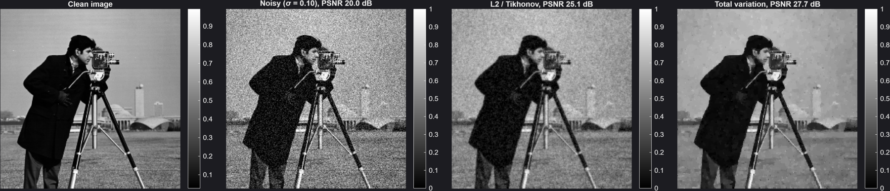
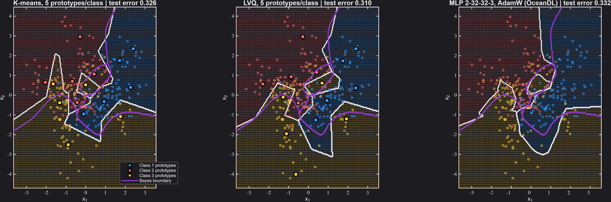
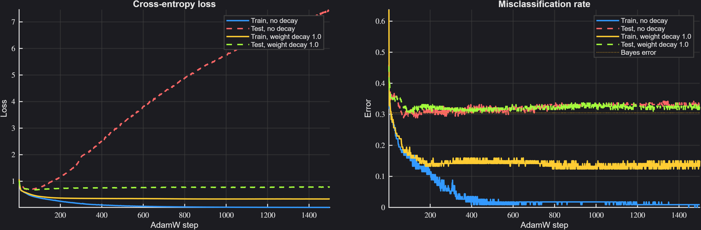
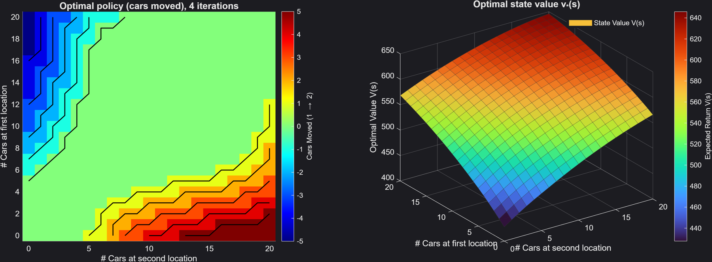

# Ocean Library

A from-scratch research library, written mostly in MATLAB, covering statistical
learning, deep learning, NLP, reinforcement learning, numerical mathematics and
the data and visualisation infrastructure around them.

The goal is understanding rather than black-box use: each algorithm is
implemented from its textbook or original paper, kept readable, and covered by
unit tests.

| | |
| --- | --- |
| MATLAB source files | about 2,400 |
| Top-level packages | 15 |
| Unit-test files (`matlab.unittest`) | about 490 |
| Experiment and demo scripts | about 265 |
| Other languages | Python (replay twin, experiments), Rust (storage engine) |

## Results

Four small experiments, all computed by the library on a CPU in a few
minutes. They are reproduced by
[`Experiments/Scripts/Showcase/make_readme_figures.m`](Experiments/Scripts/Showcase/make_readme_figures.m).

**Robust image denoising.** Gaussian noise (σ = 0.1) removed by minimising
½‖f − g‖² + λ Σ ρ(Df). The quadratic penalty (Tikhonov, solved by IRLS)
blurs edges; total variation (solved by the Chambolle–Pock primal-dual
algorithm) keeps them. λ for each penalty was picked from a small PSNR grid.



**Prototype classifiers vs a neural network.** The three-class Gaussian
mixture setting of *The Elements of Statistical Learning*, Figure 13.1:
K-means and LVQ prototypes against a 2-32-32-3 MLP trained with the
library's own autograd engine. Purple is the Bayes decision boundary
(Bayes test error 0.305).



**Overfitting and weight decay.** With 113 training points, the MLP without
weight decay drives training error to zero while its test loss climbs past 7.
Decoupled weight decay (AdamW) keeps the test loss below 0.8; the test error
of both stays near the Bayes rate.



**Jack's car rental (Sutton & Barto, Example 4.2).** Policy iteration on the
441-state problem converges in four iterations to the optimal policy (cars
moved overnight) and state values.



## Packages

| Package | What it contains |
| --- | --- |
| `+OceanMath` | Linear algebra, quaternions, information theory, signal processing, geometry and meshes, simulation |
| `+OceanStats` | Statistical learning (regression, classification, trees, ensembles, GAMs, MARS, mixtures of experts, model selection), reinforcement learning (dynamic programming, Monte Carlo, TD, Dyna, R-max and E3), game theory |
| `+OceanDL` | Tensor autograd engine with a PyTorch-style module system; CNN, RNN and Transformer layers; Vision Transformer; VAE and VQ-VAE; diffusion models (U-Net, DiT) |
| `+OceanNLP` | Tokenizers (BPE, WordPiece), embeddings, dense, hybrid and late-interaction retrieval, approximate-nearest-neighbour indexes, RAG pipeline, speech features and ASR |
| `+OceanAlgo` | Optimisation, greedy search, KD-tree, state-space search (A*, IDA*, beam search), compression |
| `+OceanAgents` | Game-theoretic multi-agent system: worlds, rules, guards and runtime |
| `+OceanReplay` | Record a computation once and replay it step by step (MATLAB, with a Python twin) |
| `+OceanData` | Data lifecycle: data lake, warehouse, feature store, schema registry, PostgreSQL, Cassandra and Redis adapters, synthetic data generators |
| `+OceanPipeline` | Ingestion, transforms and orchestration |
| `+OceanStorage` | Storage-engine study in Rust: paged B+ tree, write-ahead log, crash recovery, with MATLAB, Python and Java clients |
| `+OceanEngine` | Shared system infrastructure |
| `+OceanViz` | Visualisation engine: themes, plot strategies, simulation rendering and interactive apps |
| `+OceanCS` | Scheduling strategies |
| `+OceanTools` | Developer utilities and code templates |
| `+OceanTest` | Test suites for all of the above |

## Design

- **Strategy interfaces.** New models, metrics, smoothers and plot types are
  added as new classes behind an interface (`IModelStrategy`, `IMetricStrategy`,
  `ISplineStrategy`, `IVizStrategy`); existing classes are not modified.
- **Package boundaries by domain.** Statistics, deep learning, NLP and
  mathematics live in separate top-level packages; shared code never sits
  inside a domain package.
- **Sources are cited.** Mathematics follows the textbook or paper it comes
  from (for example Hastie, Tibshirani and Friedman; Sutton and Barto;
  Goodfellow, Bengio and Courville).

Guides and recipes are in [`docs/`](docs/index.md).

## Getting started

Developed on Windows with a recent MATLAB release. Some packages use the
Statistics and Machine Learning, Signal Processing, Image Processing and
Parallel Computing toolboxes.

```matlab
% From the repository root
addpath(pwd)

% Run the tests for one package
results = OceanTest.TestRunner.runPackage('OceanMath');

% Or use the build tool
buildtool test
```

Plotting goes through one engine:

```matlab
viz = OceanViz.Core('Theme', 'Dark');
viz.plot(ax, 'StrategyName', data)
```

Demo and research scripts are under `Experiments/Scripts/`, grouped by topic.

## What is not in this repository

Datasets, trained checkpoints, generated figures and videos are excluded.
Experiments that need a dataset expect it under a local `Data/` folder; the
third-party datasets used (for example the ESL datasets, 20 Newsgroups and
AffectNet) must be obtained from their original sources under their own
licences. Database drivers (JDBC JARs) are not bundled either.
