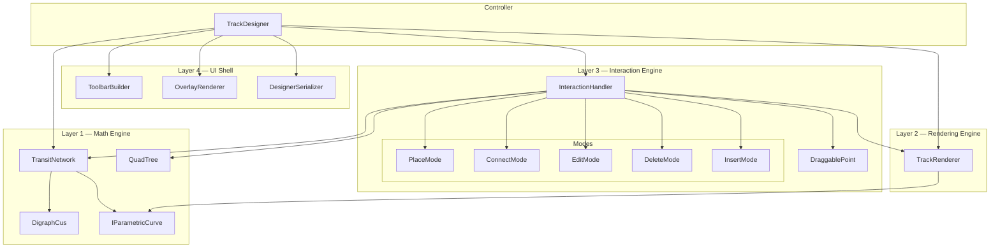
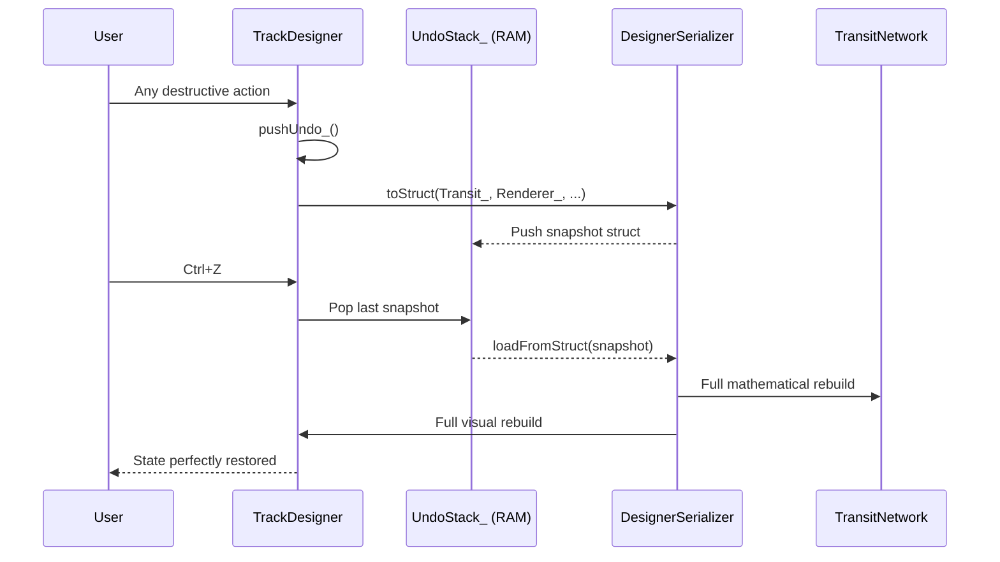
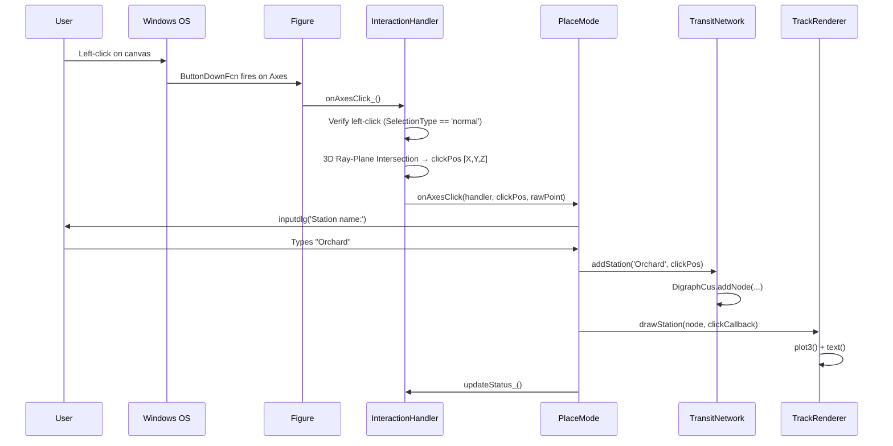
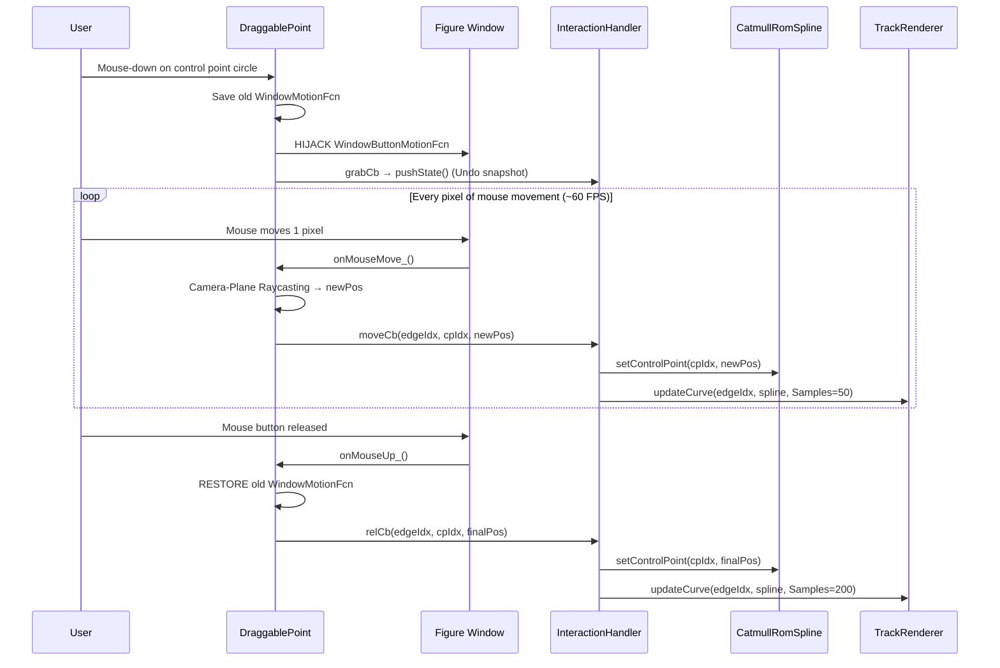

# TrackDesigner — Complete Architecture Reference

> **For developers and AI agents. Read this before modifying any Designer code.**
> Package: `+OceanViz/+Designer/` | Updated: 2026-04-01

---

## 1. Overview

TrackDesigner is a fully interactive GUI for designing transit networks (subway maps, bus routes). Users place stations, connect them with mathematically smooth spline curves, drag control points to reshape curves in real-time, and export the result as a weighted graph for simulation.

It is built on top of the Ocean Library's pure math engine (`OceanMath`) and follows a strict **Model-View-Controller (MVC)** architecture across 4 separated layers.

> [!TIP]
> **Performance Milestone:** The QuadTree spatial index + AABB early-rejection + low-res drag rendering enable fluid 60 FPS interaction even on dense transit maps with thousands of stations.

---

## 2. The 4 Architectural Layers

Lower layers **never** import upper layers. This is strictly enforced.



---

## 3. File-by-File Breakdown

### Layer 1 — Math Engine (`+OceanMath`)

These classes contain **zero** UI code. They can run headlessly without a monitor or GUI.

| File | Role | Key Methods |
|------|------|-------------|
| `TransitNetwork.m` | Central graph database. Stores stations, routes, splines, transit lines. | `addStation`, `addRoute`, `getSpline`, `getGraph` |
| `DigraphCus.m` | Generic directed graph with adjacency matrix. | `addNode`, `addEdge`, `removeEdge`, `getNodePositions` |
| `CatmullRomSpline.m` | Centripetal Catmull-Rom curve. Barry-Goldman recursive evaluation. | `evaluate(t)`, `setControlPoint`, `arcLength` |
| `BezierCurve.m` | de Casteljau Bezier curve with endpoint interpolation. | `evaluate(t)`, `setControlPoint` |
| `QuadTree.m` | 2D spatial index. Recursive quadrant subdivision. | `findNearest(pt, r)`, `rangeQuery`, `queryBox` |
| `TransitLine.m` | Line identity: name, color, route ordering, station membership. | `registerStation`, `hasStation`, `getRoute` |

> [!IMPORTANT]
> All spline classes inherit from `IParametricCurve` (abstract interface). Code should always reference the interface, never concrete classes directly, to support polymorphic spline types.

---

### Layer 2 — Rendering Engine

| File | Role |
|------|------|
| `TrackRenderer.m` | GPU painter. Draws station circles, spline curves, control point markers, halo overlays. Owns every MATLAB graphics handle. |

**Key Responsibilities:**
- `drawStation(node, clickCb)` — Paints a colored circle + text label at a station's XY position, wires click callback
- `drawCurve(edgeIdx, spline)` — Evaluates spline at N samples and renders as a smooth `line()` object
- `drawControlPoints(edgeIdx, spline, grabCb, moveCb, relCb)` — Creates `DraggablePoint` instances for each control point
- `findNearestCurve(ray, threshold)` — 3D Ray-to-Curve collision detection with AABB pre-filter
- `updateStationStyle(nodeId, style, color)` — Applies interchange/terminal/standard visual overrides
- `bringStationsToFront()` — Z-order management ensuring station circles are always clickable above curves
- LOD decluttering — Hides minor labels and station details when `ZoomedIn_ == false`

> [!WARNING]
> The `TrackRenderer` never computes adjacency matrices or routes directly. It strictly consumes pre-evaluated coordinate arrays from the `OceanMath` engine.

---

### Layer 3 — Interaction Engine

| File | Role |
|------|------|
| `InteractionHandler.m` | Central nervous system. Routes mouse/keyboard events to the active Mode. Owns shared infrastructure: zoom-to-cursor, right-click pan, Ctrl+Z/Y shortcuts, 3D ray-plane intersection math. |
| `DraggablePoint.m` | Lightweight draggable marker implementing the Observer Pattern. Hijacks `WindowButtonMotionFcn` for smooth frame-independent dragging. Camera-plane raycasting for 3D movement. |
| `IDesignerMode.m` | Abstract interface for the State Pattern. Defines 6 mandatory methods: `onAxesClick`, `onStationClick`, `enter`, `exit`, `getStatusText`, `getName`. |
| `PlaceMode.m` | Prompts for station name via `inputdlg`, calls `addStation()`. |
| `DeleteMode.m` | Finds nearest station (`QuadTree`) or curve (`findNearestCurve`) and vaporizes it. |

> [!NOTE]
> **Adding a new Mode:** Create a new class in `+Modes/` that extends `BaseMode` (which implements `IDesignerMode`). Register its string key in `InteractionHandler.createMode_()`. No other files need modification.

---

### Layer 4 — UI Shell

| File | Role |
|------|------|
| `ToolbarBuilder.m` | Static UI factory. Builds buttons, dropdowns, checkboxes. Contains zero business logic. Uses **Dependency Injection** via callback struct. |
| `OverlayRenderer.m` | Draws legends, weight labels, and draggable map titles on top of the canvas. Supports km/mi unit toggling. |
| `DesignerSerializer.m` | Save/Load engine. Handles `.mat` binary snapshots, JSON import/export, undo RAM snapshots. Performs ID remapping via `containers.Map` for cross-session compatibility. Polymorphic spline instantiation from class name strings. |

---

### Controller (The Brain)

| File | Role |
|------|------|
| `TrackDesigner.m` | God Object. Owns all other objects. Wires MATLAB figure callbacks to `InteractionHandler`. Manages application lifecycle (`launch`, `onClose_`). Provides public programmatic API (`addStation`, `connectStations`, `exportGraph`). |

---

## 4. Design Patterns

### 4.1 Model-View-Controller (MVC)

| Role | Classes |
|------|---------|
| **Model** | `TransitNetwork` + `DigraphCus` + `IParametricCurve` + `TransitLine` |
| **View** | `TrackRenderer` + `OverlayRenderer` + `ToolbarBuilder` |
| **Controller** | `TrackDesigner` + `InteractionHandler` |

The Model knows nothing about pixels. The View knows nothing about transit logic. The Controller bridges them.

### 4.2 State Pattern (Mode System)

Instead of a massive `switch/case` block, the application uses polymorphism. The `InteractionHandler` holds a single `ActiveMode_` reference pointing to whichever `IDesignerMode` is currently active:

```
IDesignerMode (Abstract Interface)
    ├── PlaceMode      — Click canvas → prompt name → spawn station
    ├── ConnectMode    — Click station A → click station B → draw spline
    ├── EditMode       — Show DraggablePoints → drag to reshape curves
    ├── DeleteMode     — Click station or curve → vaporize from math + GPU
    └── InsertMode     — Click curve → split into 2 halves, insert station
```

`setMode_('edit')` destroys the old Mode, boots a new `EditMode` into RAM, calls `.enter()`, highlights the toolbar button, and updates the status bar text.

### 4.3 Observer Pattern (DraggablePoint)

`DraggablePoint` fires 3 anonymous callbacks (Grabbed, Moved, Released) without knowing who is listening. The `InteractionHandler.makeCallbacks_()` factory manufactures the 3 function-handle wires that route the Observer signals back to the spline math engine.

This creates complete decoupling: `DraggablePoint` can be reused in any MATLAB application that needs draggable markers, without any dependency on the transit system.

### 4.4 Factory Method

```matlab
function mode = createMode_(~, modeName)
    switch modeName
        case 'place',   mode = PlaceMode();
        case 'connect', mode = ConnectMode();
        case 'edit',    mode = EditMode();
        case 'delete',  mode = DeleteMode();
        case 'insert',  mode = InsertMode();
    end
end
```

### 4.5 Dependency Injection

`ToolbarBuilder.buildToolbar(figure, callbackStruct)` receives a struct of function handles:
```matlab
cb = struct('setMode', @(m) handler.setMode_(m), ...
            'onUndo',  @() designer.onUndo_(), ...
            'onSave',  @() designer.onSave_());
```
The ToolbarBuilder has zero knowledge of `TrackDesigner` or `InteractionHandler`. It just calls whatever functions are injected.

### 4.6 Memento Pattern (Undo/Redo)



The undo stack is capped at 20 entries to prevent unbounded RAM growth.

---

## 5. 3D Raycasting Systems

Three separate raycasting systems exist in the application, all built on the same fundamental `pFront`/`pBack` laser beam technique but solving different geometric problems:

### 5.1 Ground-Plane Raycaster (InteractionHandler)

**Purpose:** Translate a 2D mouse click into a 3D coordinate on the working ground plane.
**Used by:** All Modes (Place, Connect, Delete, Insert).
**How:** Checks camera angle (`az`, `el`) via `view()`, then intersects the mouse laser beam with the appropriate axis-aligned ground plane:
- Top-down view (`el >= 89.9`): Intersect Z = `WorkingPos_(3)`
- Front view (`el <= 0.1, az <= 0.1`): Intersect Y = `WorkingPos_(2)`
- Side view (`el <= 0.1, az ~= 90`): Intersect X = `WorkingPos_(1)`

### 5.2 Camera-Plane Raycaster (DraggablePoint)

**Purpose:** Allow smooth dragging of a point across an invisible plane parallel to the user's screen.
**Used by:** EditMode (control point dragging).
**How:**
1. Compute camera Normal vector: `N = normalize(camPos - camTgt)`
2. Build invisible plane at `DragStartPos_` with normal `N`
3. Solve Ray-Plane intersection: `t = dot(N, DragStartPos_ - pFront) / dot(N, v)`
4. Teleport point: `newPos = pFront + t * v`

**Special Mode:** Alt-click activates "Elevator Mode" which hijacks the mouse's 2D Y-axis pixel movement and pumps it into the simulated Z-axis for elevation control.

### 5.3 Collision Raycaster (TrackRenderer)

**Purpose:** Detect if the mouse laser beam passes near a rendered curve.
**Used by:** DeleteMode, InsertMode via `findNearestCurve()`.
**How:** For each curve, projects every rendered vertex onto the laser beam, computes perpendicular distance. Returns the edge index of the closest hit.
**Optimization:** AABB (Axis-Aligned Bounding Box) pre-filter skips curves whose bounding boxes don't overlap with the search region.

---

## 6. Event Flow — Full Click-to-Station Lifecycle



---

## 7. Event Flow — Full Drag Lifecycle



---

## 8. Data Persistence

```
TrackDesigner
    │
    ├── pushUndo_() → DesignerSerializer.toStruct()
    │                 → RAM struct → UndoStack_{end+1} (max 20)
    │
    ├── saveDesign(path) → DesignerSerializer.saveMAT()
    │                      → .mat binary file on disk
    │
    ├── exportJSON_(path) → DesignerSerializer.exportJSON()
    │                       → .json text file (language-agnostic)
    │                       → ID compaction, ghost node purging
    │
    └── loadDesign(path) → DesignerSerializer.loadMAT()
                           → resetState_() + full rebuild
                           → Polymorphic spline instantiation from class names
```

> [!IMPORTANT]
> JSON import uses `containers.Map` (`idMap`) to translate between legacy file IDs and fresh runtime IDs. This prevents ID collision when loading networks created in different sessions.

---

## 9. Performance Optimizations

| Optimization | Location | Complexity Change |
|-------------|----------|-------------------|
| **QuadTree spatial index** | `InteractionHandler.findNearestStation_` | O(N) → O(log N) |
| **AABB early-rejection** | `TrackRenderer.findNearestCurve` | Skips distant curves without per-vertex math |
| **Low-res drag rendering** | `onControlPointMoved_` uses `Samples=50` | 4x fewer vertices during drag |
| **High-res final render** | `onControlPointReleased_` uses `Samples=200` | Ultra-HD curve on mouse release |
| **LOD decluttering** | `onZoomCheck_` + `ZoomThreshold` | Hides minor labels when zoomed out |
| **Edge-triggered redraw** | `ZoomedIn_ ~= isZoomedIn` guard | Prevents redundant LOD recalculations |
| **Handle class pointers** | All spline modifications via `< handle` | Zero-copy mutation via memory reference |
| **Vectorized fallback** | `findNearestStation_` when QuadTree absent | 50-100x faster than for-loop |

---

## 10. Complete Dependency Tree

```
TrackDesigner (Controller)
├── TransitNetwork (Model — pure math, no UI)
│   ├── DigraphCus (generic directed graph)
│   │   ├── Node.m (immutable value object: Id, Name, Position)
│   │   └── Edge.m (immutable value object: Source, Target, Weight)
│   ├── TransitLine (line identity: name, color, route)
│   └── IParametricCurve (abstract spline interface)
│       ├── CatmullRomSpline (centripetal, Barry-Goldman)
│       └── BezierCurve (de Casteljau)
├── TrackRenderer (View — GPU painter, no logic)
│   └── DraggablePoint (interactive marker, Observer Pattern)
├── InteractionHandler (Controller — input dispatcher)
│   ├── IDesignerMode (State Pattern interface)
│   │   ├── PlaceMode
│   │   ├── ConnectMode
│   │   ├── EditMode
│   │   ├── DeleteMode
│   │   └── InsertMode
│   └── QuadTree (2D spatial index, O(log N))
├── ToolbarBuilder (View — static UI factory, DI)
├── OverlayRenderer (View — legends, weights, titles)
└── DesignerSerializer (Persistence — save/load/undo)
```

---

## See Also

- [TrackRenderer Deep Dive](TrackRenderer_DeepDive.md) — Detailed rendering pipeline
- [QuadTree Guide](quadtree_guide.md) — Spatial index usage and internals
- [Parametric Curves](parametric-curves.md) — Spline mathematics
