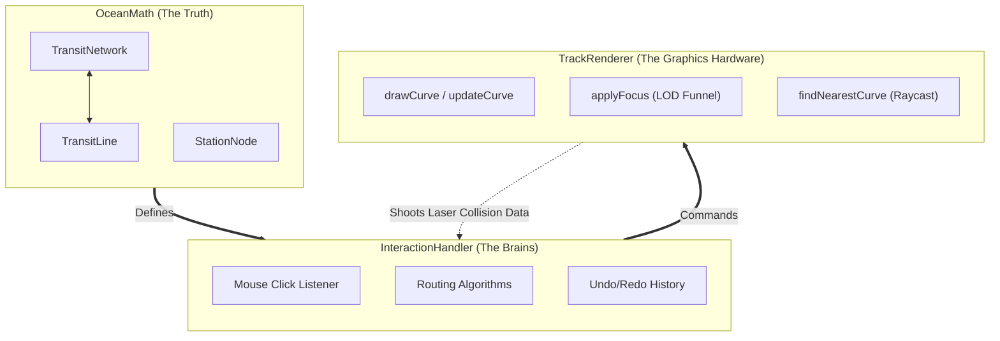
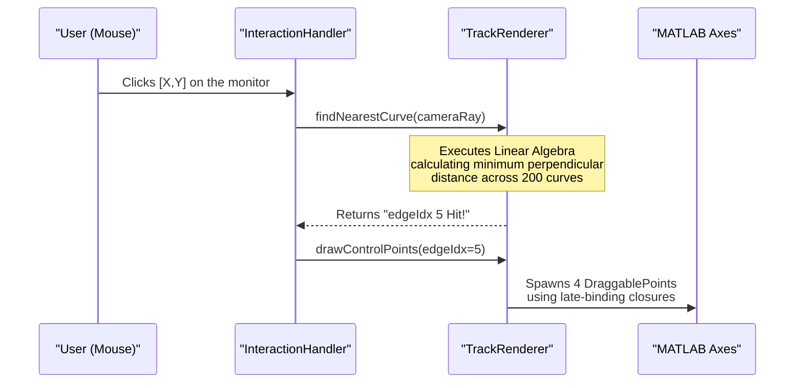

# TrackRenderer.m — The Graphics Architecture Engine

`TrackRenderer` is the absolute mechanical core of the View layer in the MVC architecture of the TrackDesigner. It is entirely responsible for negotiating the translation of pure mathematical equations (from `OceanMath`) into native, hardware-accelerated OpenGL pixels on the MATLAB canvas.

## 1. The Core Architectural Role

In modern GUI architecture, **The View must be completely "Dumb"**. 
`TrackRenderer` knows absolutely nothing about actual Graph Theory arrays, Adjacency Matrices, or Dijkstra network algorithms. Its only job is to aggressively memorize Graphics Pointers (GPU handles) and accept blind commands from the `InteractionHandler` (The Controller).

## 2. Rendering Philosophies & Optimization Hacks

MATLAB's graphics thread is incredibly delicate. If overwhelmed with massive `for` loops destroying and recreating graphics (like a 50-line subway map loaded from a JSON file), the application's FPS drops to zero. `TrackRenderer` implements four massive optimization paradigms to circumvent this:

### A. Surgical Property Injection (`set(...)`)
Instead of executing `delete()` and rebuilding a curve using `plot3()` when a user drags a track, the Renderer surgically extracts the existing GPU pointer from its memory array (`obj.CurveHandles_{edgeIdx}`) and natively writes the updated coordinates directly into the graphics register using `set(h, 'XData', newX)`. This allows the UI to perfectly achieve 60 FPS while dragging.

### B. The Funnel Architecture (`applyFocus`)
To prevent "State Spaghetti" where 15 different checkbox actions accidentally overwrite each other, visibility logic is heavily funneled through the Single Source of Truth: `applyFocus`.
Whether the user pans the camera out, clicks "Hide Labels", or toggles "Focus Mode", the application drops the parameter combinations perfectly into the `applyFocus` funnel. The funnel calculates the single geometric truth for all elements exactly once.

### C. The 3D Component Masking (The Laser Beam)
Because Train Tracks are tiny 4-pixel splines, relying on native GUI `.ButtonDownFcn` hits is extremely buggy. `TrackRenderer` structurally forces `HitTest = 'off'` on background elements (like massive White overpass Halos) and utilizes a purely mathematical 3D Infinite Ray vector algorithm (`findNearestCurve`). 
When a user clicks the glass monitor, it calculates the Euclidian perpendicular distance (`W_perp`) from that single laser beam to every vertex of a train line to natively pinpoint flawless Cartesian intersections.

### D. The Painter's Algorithm & Intersections
MATLAB strictly executes 2D canvas drawing geometry sequentially (Whatever is drawn *last* sits on *top*).
1. **The Halo Illusion**: Elevated Overpasses (`DrawOrder > 0`) are rendered using two separate lines natively. A massive White line is drawn structurally underneath a skinny Colored line. To the human eye, the massive white line visually acts as an eraser stencil slicing through any perpendicular curves sitting beneath it!
2. **`bringStationsToFront`**: Because manipulating massive curves usually mathematically forces them to physically cover the Station White dots... this `O(1)` cleanup function aggressively flat-packs all 200 Station Pointers into a single native array (`gobjects`) and forcefully mathematically shoves them all collectively to the absolute top Z-index buffer using a singular `uistack` command natively.
